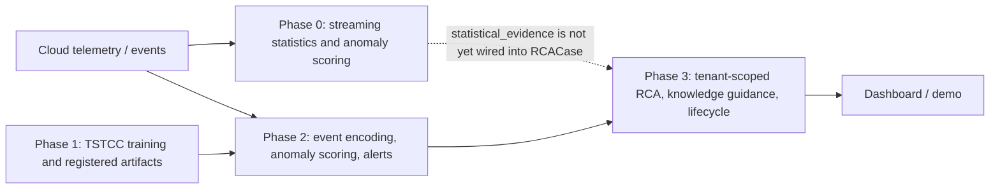

# CAPSTONE-189

AI-assisted, multi-cloud anomaly and security-alerting capstone. The runnable synthetic demo combines the existing Phase 2 scoring/alerting path with Phase 3 deterministic RCA, knowledge guidance, onboarding, and an investigation dashboard.

## Current Status

- Synthetic end-to-end flow: tested.
- Python and frontend validation commands are listed below; results should be
  taken from the current run rather than copied from an earlier work report.
- Live cloud credentials, Postgres deployment, and external SMS/Webhook/PagerDuty delivery: not configured by the synthetic demo.
See the [final project report](FINAL_PROJECT_REPORT.md) for the canonical
layout, current verification results, and remaining limitations. The
[revised implementation design](docs/REVISED_LLD_IMPLEMENTATION_2026-10-12.md)
contains the detailed module/function map and integration contracts.
See [the architecture overview](docs/architecture.md) for the Phase 0–3 data flow.
See the [threat library](docs/threat_library.md) and [knowledge-base authoring guide](docs/knowledge_base_authoring.md) for the deterministic, static guidance contracts.

## Quick Start

From this directory, install Python requirements and start the backend from the project root so relative rule/config paths resolve:

```powershell
python -m pip install -r requirements.txt
$env:CAPSTONE_DATABASE_URL = 'sqlite:///./capstone_phase3_live_demo.db'
python -m uvicorn phase3.api.app:app --host 127.0.0.1 --port 8001
```

In a second terminal:

```powershell
cd frontend
npm install
npm run dev
```

Open `http://127.0.0.1:5173/`. The backend API documentation is at `http://127.0.0.1:8001/docs`.

To use frontend fixtures without a backend, set `VITE_MOCK_MODE=true` in `frontend/.env`; set `VITE_API_BASE` to override the API URL. A template is provided in `frontend/.env.example`.

### Docker services

From the repository root, start the local infrastructure used by the streaming
and persistence paths:

```powershell
docker compose up -d
docker compose ps
```

The Kafka quick check and Phase 0 producer verification are in the
[Kafka setup section](#kafka-setup-and-verification). Stop the services with
`docker compose down` when finished. This does not remove named volumes; use
`docker compose down -v` only when intentionally discarding local service data.

### Demo login and incident investigations

Start a local demo session from `/login` to create/use the synthetic `demo-user` and its memberships for the bundled demo tenants. This login is intentionally for local demonstration only; it is not production authentication. Phase 3 routes continue to validate `X-User-Id` membership against `X-Tenant-Id`.

Generate an attack from **Live demo** to see the matching RCA explanation and recommended checks. The scenario context and observed features are shown alongside the evidence-derived RCA category; selecting a scenario does not force a confident diagnosis. The full incident investigation is available from the demo result, dashboard alert rows, alert feed, or **Incidents & RCA**. It loads the case, explanation, recommended checks, and notification deliveries from one tenant-scoped `/incidents/{incident_id}/investigation` response. Existing explanation and recommendation endpoints remain available for compatibility.

To onboard a tenant, sign in to the local demo, open **Onboarding**, create a
workspace in **Synthetic demo** mode, and complete the seven resumable setup
steps. To resolve an incident, open it from **Incidents & RCA**, select
**Resolve incident**, choose the outcome, complete any threat-specific
resolution checklist, and confirm. **Acknowledge**, **Resolve**, and **Reopen**
are available to tenant owners/operators; viewers are read-only. Mitigation
text is human guidance only: the platform does not execute cloud changes.

### Run a synthetic alert (inference/demo path)

The Phase 2 detector runs through the application pipeline; there is no
standalone inference CLI. To exercise the local synthetic alert path without
live cloud credentials:

```powershell
python scripts/run_local_demo.py --tenant amazon --scenario credential_theft --channel PAGE
```

For the interactive path, start the backend and frontend above, log in, open
**Live demo**, choose a scenario/provider/intensity, and select **Inject**.
Scenario labels are demo/test metadata; the returned RCA is based on observed
signals and can legitimately remain UNKNOWN.

### Train and register a model bundle

Training requires an event-based `aug_pairs.parquet` that matches the current
training schema. Do not feed the older wide-schema output from the legacy pair
generator into this trainer. See [model registry rebuild
instructions](model_registry/README.md) for generating the 32-resource
synthetic seed corpus, metadata, and a compatible training input. From the
repository root, train and build an index with the same corpus:

```powershell
python -m phase1.train.train_tstcc --parquet <aug_pairs.parquet> --epochs 20 --checkpoint-dir model_registry
python scripts/build_faiss_index.py --parquet <aug_pairs.parquet> --checkpoint model_registry/tstcc_encoder_final.pt --out model_registry/behavioral_space
```

Generate `feature_meta.json` from that exact training corpus before registering
the encoder, and register the matching checkpoint, metadata, configuration,
and FAISS prefix together. At runtime, Phase 2 uses
`ArtifactBundle.load_latest()`; see the registry instructions for the Python
registration example. Never pair a checkpoint with metadata or an index made
from a different vocabulary/corpus.

### Phase 0–3 data flow



The dashed Phase 0 edge is a documented integration gap, not a live data
contract. Phase 2 currently builds Phase 3 investigations from alert evidence;
the independent Phase 0 statistical scores are not attached to `RCACase`.

## Kafka setup and verification

The local Docker Compose stack provides Kafka with ZooKeeper. Start the broker:

```powershell
docker compose up -d zookeeper kafka
docker compose ps
```

Wait for both services to report `Up`, then verify the broker responds and
create the Phase 0 sample topic:

```powershell
docker compose exec kafka kafka-topics --bootstrap-server localhost:9092 --list
docker compose exec kafka kafka-topics --bootstrap-server localhost:9092 --create --if-not-exists --topic vm-metrics-stream --partitions 1 --replication-factor 1
```

From the project root, run the delivery-checking producer. It sends 30 stable
readings and one deliberate outlier and exits non-zero if Kafka does not
confirm every message:

```powershell
python scripts/test_phase0_producer.py
```

The script should report `All 31 points confirmed delivered.` To observe the
streaming consumer and its Redis-backed baseline end to end, start the full
stack with `docker compose up -d` and follow the two-terminal procedure in
`scripts/test_phase0_consumer_e2e.py`.

## Main Components

- `phase0/`: streaming, bucketing, rolling baselines, seasonality, and statistical scoring.
- `phase1/`: historical corpus, contrastive encoder, FAISS indexing, and model registry.
- `phase2/`: ingestion, encoding, anomaly/drift/episode scoring, alerting, deduplication, escalation, and notification interfaces.
- `phase3/`: platform schema, identity, cloud-connect services, onboarding, notifications, deterministic RCA, knowledge base, and security helpers.
- `live_ingestion/`: provider connectors, shared read-only polling, and vocabulary mapping.
- `alembic/`: root migration environment and platform schema migration.
- `phase3/api/`: FastAPI demo API and Phase 3 routes.
- `frontend/`: React/TypeScript dashboard, demo controls, onboarding, connections, incidents, and RCA screens.
- `demo_generator/`: canonical importable synthetic scenario generator and scenario fixtures.
- `tests/`: unit, API, and integration coverage.

## Verification

```powershell
python -m pytest -q
python -m pip check
cd frontend
npm ci
npm run lint
npm run typecheck
npm test
npm run build
```

Use read-only cloud identities and dry-run mode before configuring any live connector. The demo's connections view reports channels requiring provider credentials; it does not claim those providers are delivering.
