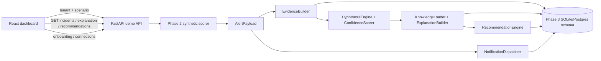

# CAPSTONE-189 End-to-End Project Assessment

**Assessment date:** 2026-10-09  
**Canonical application tree:** `Capstone_final/`  
**Related source tree:** `Capstone_team_189/`  
**Status:** Synthetic end-to-end path verified; production multi-tenant/live-cloud integration remains incomplete.

## Executive Summary

The two sibling directories serve different purposes. `Capstone_final/` is the runnable application, with the FastAPI demo API, React dashboard, cloud-ingestor modules, model artifacts, Phase 0-2 implementation, and the integrated Phase 3 routes. `Capstone_team_189/` is the Git checkout carrying a distinct project history and uncommitted Phase 3/platform work.

Phase 3 Python modules, unit tests, and the unique identity/schema integration tests have been consolidated into `Capstone_final/`. The old checkout was deliberately retained: the audit found 71 same-path content conflicts and pre-existing changes in its Git worktree. A wholesale overwrite or deletion would risk losing work and would not resolve those conflicts correctly.

The current verified demo path runs a synthetic alert through Phase 2 scoring/alert construction, Phase 3 evidence assembly, attack-category rules, static knowledge lookup, recommendations, PAGE notification recording, SQLite persistence, and tenant-scoped incident APIs. The dashboard now exposes onboarding, connections, incidents, and RCA detail pages.

**Verification snapshot:** 211 Python tests passed; the frontend production build passed; `pip check` reported no broken requirements. Seven deprecation warnings remain. Docker/PostgreSQL was not available for a real database deployment test.

## Sister-Directory Reconciliation

The sibling-tree inventory at audit start (excluding caches, bytecode, node modules, build output, and SQLite runtime files; before importing the two unique identity/schema integration tests) found:

| Measure | Result |
| --- | ---: |
| Files in `Capstone_final/` | 312 |
| Files in `Capstone_team_189/` | 163 |
| Shared relative paths | 135 |
| Identical shared files | 64 |
| Different shared files | 71 |
| Files only in `Capstone_final/` | 177 |
| Files only in `Capstone_team_189/` | 28 |

The Phase 3 package source (`.py` and `.yaml`) and `tests/unit/phase3/` were merged into the canonical tree. The unique Phase 3 identity/schema integration tests were also brought over. Shared top-level Phase 2 contracts were not replaced as part of this consolidation.

The duplicate `demo-generator/generator.py` implementation is now a compatibility re-export of `demo_generator.generator`; the hyphenated launcher and required scaffold remain functional. Runtime SQLite databases and historical email logs were retained rather than deleted as they contain run state/audit output.

### Why the Old Checkout Remains

`Capstone_team_189/` has pre-existing tracked and untracked changes, including `shared/types.py`, Docker configuration, Phase 3 packages, and tests. There are 71 differing shared paths, including active Phase 0-2 modules and dependencies. The correct next consolidation step is a reviewed conflict-by-conflict merge, not deleting the Git checkout. No existing user changes in that tree were removed.

## Technology Stack

| Area | Libraries / tools | Current role |
| --- | --- | --- |
| Runtime | Python (validated here on 3.14; project guidance targets Python 3.10+) | Phase 0-3 backend, training and tests |
| HTTP/API | FastAPI, Pydantic, Uvicorn, HTTPX | REST APIs, request validation, test client, ASGI serving |
| Frontend | React 18, TypeScript 5, Vite 5, React Router 6 | Dashboard UI, routes, development and production builds |
| Frontend styling | Project CSS and inline styles | Current visual system; Tailwind is specified in the plan but is not installed/used |
| Numeric/ML | NumPy, PyTorch, FAISS CPU, pandas, PyArrow, NetworkX | Embeddings, encoder/model training/inference, vector retrieval, graph correlation and corpus data |
| Streaming/storage | Redis/fakeredis, Kafka/confluent-kafka, asyncpg, PostgreSQL/pgvector | Phase 0-2 ingestion/entity-store patterns; real services are not required for the synthetic E2E path |
| Phase 3 persistence | SQLAlchemy, Alembic, psycopg | Platform relational models/migrations; the demo defaults to SQLite, configurable with `CAPSTONE_DATABASE_URL` |
| Identity/security | bcrypt, PyJWT, cryptography/Fernet, python-dotenv, PyYAML | Password/JWT services, encrypted credentials, environment and rule/knowledge configuration |
| Cloud SDKs | boto3, google-cloud-pubsub; provider packages/configs for Azure/GCP/OCI are present in the broader project | Cloud connectors and ingestion support; credentials and live provider calls are not part of the verified demo |
| Notifications | stdlib SMTP, HTTPX-injected channel notifiers, HMAC-SHA256 | Existing email/demo path plus Phase 3 SMS, webhook and PagerDuty notifier implementations |
| Verification | pytest, flake8, npm build, Python package checks | Unit, API, integration and frontend build validation |

**Planned but not currently used in the frontend:** Zustand, React Query, Recharts, and Tailwind v4. The implemented pages use React state, `fetch`, React Router and CSS.

## Module and Function Build

### Phase 0: Streaming and Baselines

- `MetricPoint`, `BucketKey`, `BucketState`, `ScoreResult` define metric/scoring contracts.
- `BaseStreamReader`, `KafkaStreamReader`, `RedisStreamReader` read streaming data.
- `BucketKeyResolver` and the Welford/robust-statistics accumulators feed rolling baselines.
- `SeasonalityClassifier`, `ZScoreScorer`, and `AnomalyScoringWorker` classify and score buckets.
- **Verification status:** targeted unit suite passes. This path is not the source of the current dashboard demo alerts and its production stream wiring is not demonstrated by the E2E test.

### Phase 1: Corpus, Encoder, and Registry

- `CorpusIterator` and `StreamingAugPairsDataset` provide historical/training records.
- `generate_pairs` and augmentation functions create training samples.
- `TstccEncoder`, `Time2Vec`, `AttentionPooling`, and `NTXentLossComputer` implement the representation-learning path.
- `BatchEncoder` and `FaissIndexer` build embeddings and retrieval indexes.
- `ArtifactBundle` and `ModelRegistry` load/version model assets.
- **Verification status:** modules and project tests pass in the full suite. Training a fresh production model is not part of the current runtime demo.

### Phase 2: Ingestion, Detection, Alerting

- `BaseIngestor`, Kafka/Kinesis/PubSub ingestors, `BatchAccumulator`, `SchemaValidator`, and `IngestionPipeline` form the batch ingestion path.
- `RecordEncoder`, `InferenceEncoder`, and the current embedding aggregator produce entity representations.
- `CosineDeviationScorer`, `MmdDriftMonitor`, `EpisodeRetriever`, and `AnomalyScorer` provide deviation, drift, similarity, and final severity signals.
- `AlertDeduplicator`, `CorrelationEngine`, and `EscalationEngine` deduplicate, relate, and route alerts.
- `build_alert_payload` assembles the shared alert contract; the API module includes Slack, email, PagerDuty, dashboard writing, rate limiting, recent-alert, and WebSocket components.
- **Verified demo connection:** `Capstone_final/backend/api_demo_ext/app.py::_build_demo_alert_payload` composes the synthetic scoring/dedup/correlation/escalation path and calls the payload builder. This path is not equivalent to proving every production Kafka/Kinesis/PubSub deployment configuration.

### Phase 3: Platform, RCA, Notifications, Dashboard

| Module | Main implementation | Verified integration status |
| --- | --- | --- |
| M1 Notification foundation | `NotificationDispatcher`, endpoint/policy/result contracts, idempotency and delivery recording | Unit tested; demo dispatch records the PAGE result. Durable delivery rows are not yet written to `notification_deliveries`. |
| M2 Platform schema | SQLAlchemy rows and Alembic migration for platform entities | SQLite round-trip tests pass; a live Postgres/pgvector migration was not run. |
| M3 Identity/tenancy | `AuthService`, `TenantService`, `MembershipValidator`, repositories | Unit/integration tests pass; the demo API's Phase 3 routes do not yet enforce `MembershipValidator`. |
| M4 Onboarding | `OnboardingWizardService` and onboarding API | Resumable SQLite-backed progress and explicit live-enable confirmation are tested. Live connector validation/resource discovery are not wired into the route. |
| M5 Cloud connections | `CloudConnectionService`, resource discovery and credential store | Service modules exist; `/connections` currently reports synthetic tenant metadata, not persisted provider connections or a live `health_check()`. |
| M6 Evidence | `EvidenceBuilder`, `RCACase`, `CandidateCause` | Runs on each synthetic demo alert and stores existing scores/features without recomputing them. |
| M7 Hypothesis/confidence | YAML `HypothesisEngine`, `ConfidenceScorer` | Generic operational categories plus credential-theft, privilege-escalation and reconnaissance rules. Rules are deterministic and first-match-wins. |
| M8 Knowledge/guidance | `KnowledgeLoader`, `ExplanationBuilder`, `RecommendationEngine`, YAML knowledge base | Attack-focused entries added; structured explanation and read-only checks are returned. KB version is `2026.10.09.1`. |
| M9 SMS/Webhook/PagerDuty | `SmsNotifier`, `WebhookNotifier`, `PagerDutyNotifier` | Channel tests pass; provider credentials/endpoints are not configured in the demo, and these notifiers are not registered with the live demo dispatcher. |
| M10 Dashboard | React onboarding, connections, incident list/detail pages | Build passes; includes evidence, timeline, causes, explanation, checks, UNKNOWN fallback, and mock fixtures. |
| M11 Full demo | `process_demo_alert` plus FastAPI routes and M11 integration test | Synthetic confident and UNKNOWN paths, tenant checks, persistent RCA/KB/check reads and PAGE delivery were tested. |
| M12 Security hardening | Isolation middleware and audit logger modules | Unit contracts exist; middleware/audit enforcement is not yet installed across the demo API routes. |

## End-to-End Connections



### Primary Runtime Flow

1. The dashboard selects a tenant/scenario and posts `/demo/generate/alert`.
2. `generate_alert` calls `_build_demo_alert_payload`, which creates a Phase 2-compatible alert using the synthetic telemetry/scoring path and existing alerting components.
3. The endpoint preserves the legacy dispatch/notification response, then calls `process_demo_alert`.
4. `process_demo_alert` converts the dict into shared `AlertPayload`, calls `EvidenceBuilder`, carries `contributing_features` into `RCACase.changed_features`, runs ordered hypothesis rules/confidence scoring, builds the explanation and recommended checks, and records PAGE delivery.
5. The case, explanation, recommendations and delivery result are serialized to the `rca_cases` JSON body using `PlatformSessionFactory`.
6. The dashboard reads `/incidents`, `/incidents/{id}`, `/incidents/{id}/explanation`, and `/incidents/{id}/recommendations`. The same tenant filter is required by the API's `X-Tenant-Id` header.

## API Surface

### Existing demo API

- `GET /`, `POST /auth/login`, `GET /tenants`
- `GET /demo/scenarios`, `GET /demo/notify-methods`
- `POST /demo/generate/alert`, `POST /demo/generate/attack`
- `GET /stats/summary`, `GET /alerts/recent`
- `POST /demo/pause`, `/demo/resume`, `/demo/reset`; `GET /demo/status`
- `POST /phase2/alerting/api/alert_api`
- WebSocket `/ws/heartbeat`

### Phase 3 demo adapters

- `POST /onboarding`, `GET /onboarding/{session_id}`
- `POST /onboarding/{session_id}/steps/{step_name}`
- `GET /connections`
- `GET /incidents`, `GET /incidents/{incident_id}`
- `GET /incidents/{incident_id}/explanation`
- `GET /incidents/{incident_id}/recommendations`
- `GET /notification-deliveries`

These routes are a demo adapter, not a completed production platform API. Several endpoints currently use in-memory services or static synthetic connection descriptions.

## Expected-versus-Current Comparison

| Expected by the project plan | Current result | Gap / verification need |
| --- | --- | --- |
| Ten core M7 categories, all represented in M8 | Four generic core categories plus three security-specific categories; every emitted rule has a KB entry | Six planned core categories remain: deployment, traffic, configuration, dependency, regional, and cloud-provider event. Decide whether to implement or formally defer each. |
| Attack-relevant, evidence-grounded RCA | Credential theft, privilege escalation, and reconnaissance now map from feature combinations; explanation shows `changed_features` | Current indicators are synthetic feature names and rules, not a calibrated production threat detector. Validate against labeled attack data before operational claims. |
| KB covers each M7 output and offers read-only checks | Coverage test, versioned entries, structured sections, limitations, low-risk checks | Golden-file wording review and a socket-disabled/no-network gate should be added to CI. |
| P3-M1 deliveries persisted and endpoint-policy driven | PAGE delivery recorded in the RCA record; SMS/Webhook/PagerDuty implementations are unit tested | Add `notification_deliveries` repository persistence and configure endpoint secrets/targets; register concrete M9 notifiers in the app with safe provider-disabled behavior. |
| P3-M2 Postgres platform schema | SQLAlchemy models/migration and SQLite round-trip coverage | Run Alembic migrations against Postgres/pgvector in CI or staging; Docker was unavailable for this verification. |
| P3-M3 membership validation on tenant APIs | Tenant header scoping and cross-tenant incident 404 tests; identity service separately tested | Wire authentication and `MembershipValidator` into every tenant-scoped route. `X-Tenant-Id` alone is not authorization. |
| P3-M4 onboarding orchestrates connector health, discovery, notifications, monitoring | Resumable session API and live-mode confirmation guard | Connect wizard steps to `CloudConnectionService`, connector `health_check()`, resource discovery, and dispatcher test notifications. Do not silently enable live ingestion. |
| P3-M5 persisted cloud connections with encrypted credentials | Connector/credential modules exist; connections page reports synthetic status | Persist connections/resources, verify encryption key configuration, implement real read-only health/discovery, and never expose credentials. |
| P3-M10 dashboard investigation console | Onboarding, connections, incidents and detail screens; mock confident/UNKNOWN fixtures | Current API client lacks production auth/session handling; add loading/error/retry/refresh and endpoint management when backend contracts are ready. |
| P3-M11 full demo | Full synthetic confident and fallback path verified | Add a browser-driven test that asserts rendered UI content; current run uses API/TestClient and HTTP route smoke checks. |
| P3-M12 security hardening | Middleware and audit logger modules with unit tests | Apply middleware and audit events to the actual FastAPI router; add authenticated cross-tenant tests for all read/write endpoints. |
| One canonical source tree | `Capstone_final` is the runnable canonical root; Phase 3/tests merged; duplicate generator source reduced to shim | Keep `Capstone_team_189` until 71 path conflicts and its dirty worktree are reconciled explicitly. Do not delete the Git checkout as part of automated cleanup. |

## Verification Performed

- `python -m pytest -q` from `Capstone_final/`: **211 passed, 7 warnings**.
- `npm run build` from `Capstone_final/frontend/`: TypeScript build and Vite production build passed.
- `python -m pip check`: no broken requirements.
- Phase 3 attack hypothesis/KB contract: **7 passed**.
- Merged identity/schema integration tests: **2 passed**.
- Live HTTP E2E exercised onboarding resume, explicit live-confirmation rejection, UNKNOWN fallback, then credential-theft, privilege-escalation, and network-reconnaissance classifications. All three attack explanations returned KB version `2026.10.09.1`, their scenario indicators, and persisted recommendations through tenant-scoped routes.
- Frontend route smoke checks returned HTTP 200 for dashboard, onboarding, connections, incident list, confident/UNKNOWN incident detail, alerts, and demo pages.

Warnings observed in the full suite are three third-party SWIG deprecations and four `datetime.utcnow()` call warnings from the existing email-log path. These were not changed as part of this assessment.

## Prioritized Improvements

1. **P0 — Authorization and isolation:** require a verified JWT/session and `MembershipValidator` for every tenant-scoped read/write; audit all deny/allow cases. Treat the current header-only adapter as demo-only.
2. **P0 — Durable notification delivery:** persist every `NotificationDeliveryResult`, configure endpoint/policy repositories, and test idempotency across process restarts. Keep provider calls disabled until secrets/endpoints are configured.
3. **P1 — Complete onboarding/cloud connection orchestration:** wire credential validation to existing provider `health_check()`, resource discovery to `CloudConnectionService`, and test notification to M1. Persist per-step results in a dedicated onboarding/session model rather than using a synthetic `TenantRow` as the session container.
4. **P1 — Complete taxonomy deliberately:** decide how to implement or defer the six missing core categories, then maintain the M7-to-M8 coverage gate. Test ambiguous and contradictory evidence, not only positive feature matches.
5. **P1 — Production database gate:** run migrations and round trips against Postgres/pgvector in CI; retain SQLite for local tests only.
6. **P1 — Browser E2E:** run Playwright on desktop/mobile with both mock and live API modes, checking the UNKNOWN explanation, attack-specific evidence, recommendations, tenant switch, and onboarding guard.
7. **P2 — Knowledge quality:** peer review wording with a security analyst, add validated references, keep checks read-only, bump `kb_version` on edits, and avoid describing heuristic categories as confirmed attacks.
8. **P2 — Consolidation hygiene:** review the 71 conflicting paths, move genuinely shared documentation to one canonical location, and retire the old checkout only after the user confirms its remaining changes are preserved.
9. **P2 — Dependency hygiene:** separate Python requirements from frontend npm dependencies (already done in the canonical tree), pin supported version ranges, address the current npm audit result (6 advisories: 3 moderate and 3 high), and run a vulnerability scan in CI.

## Run the Verified Synthetic Demo

From `Capstone_final/`, install the Python requirements and frontend dependencies. Start the backend from the project root so relative rule/config paths resolve:

```powershell
$env:CAPSTONE_DATABASE_URL = 'sqlite:///./capstone_phase3_live_demo.db'
python -m uvicorn backend.api_demo_ext.app:app --host 127.0.0.1 --port 8001
```

In another terminal:

```powershell
cd frontend
npm install
npm run dev
```

Open `http://127.0.0.1:5173/`. Set `VITE_MOCK_MODE=true` in `frontend/.env` to use the frontend's confident and UNKNOWN fixtures without the API. Real SMS, webhook, PagerDuty, or cloud-provider delivery requires provider configuration and is not part of the synthetic verification.
