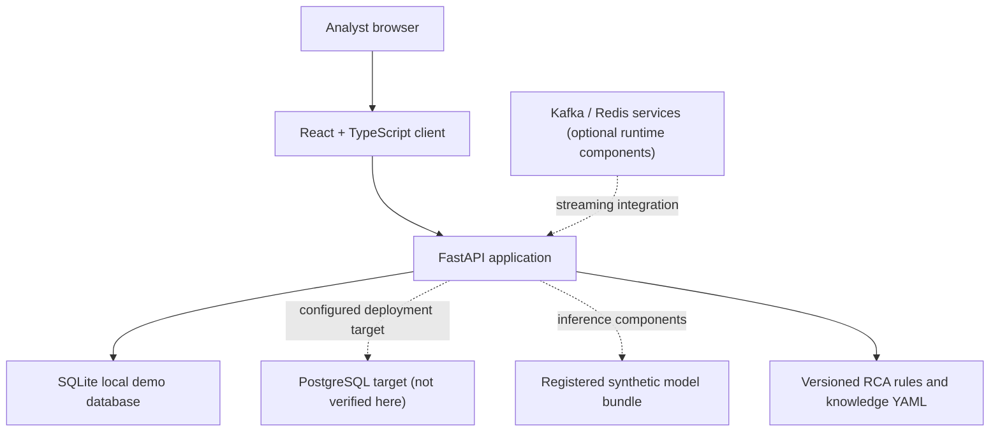
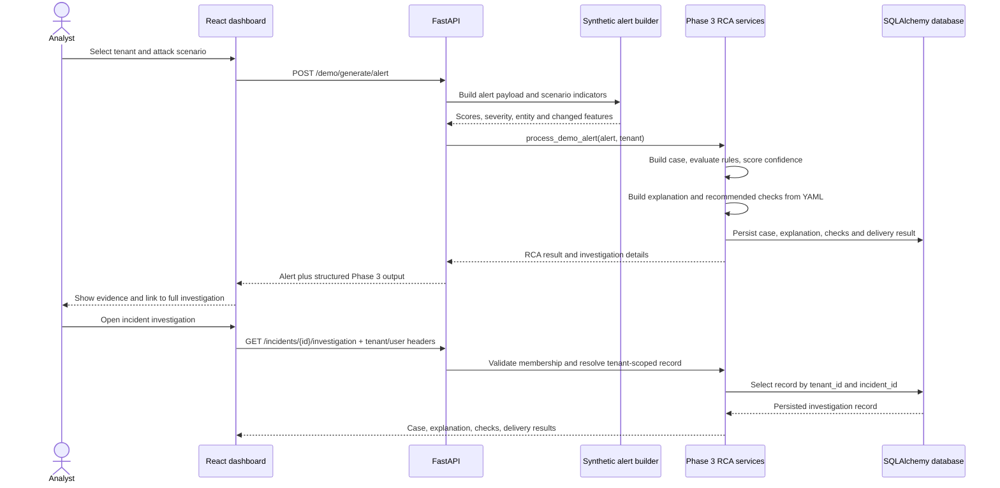
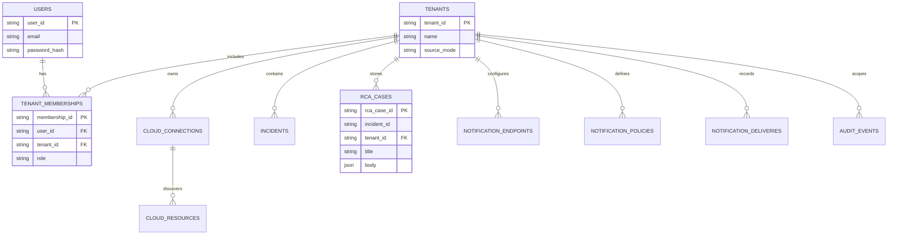

# LOW LEVEL DESIGN AND IMPLEMENTATION DOCUMENT

## Unified AIOps Framework: Building Cyber-Resilient and Autonomous IT Ecosystems

### Behavioral Anomaly Detection Platform for Multi-Cloud Environments

**Team 189 | UE23CS441A — Capstone Project Phase 3**  
**PES University — Department of Computer Science and Engineering**  
**Document revision:** 2.0 (recompiled against implementation verified on 12 October 2026)  
**Project period:** August–December 2026

**Submitted by**

| Name | SRN |
|---|---|
| Sakthi | PES2UG23CS515 |
| Lavanya | PES2UG23AM086 |
| Swathi | PES2UG23CS634 |
| Himank | PES2UG23AM044 |

**Project guide:** Guide name and designation to be confirmed by the team before submission.

---

## Document control

This revision updates the earlier low-level design to match the consolidated
`Capstone_team_189` source tree and its latest verified synthetic workflow. It
distinguishes implemented and tested capabilities from design intent and
production work that remains incomplete. It is not evidence of a production
deployment, a live-cloud security evaluation, or a calibrated threat detector.
All reported metrics are local project verification results.

## Abstract

This project implements a multi-cloud behavioral anomaly detection platform
that models the operating behavior of cloud resources and presents anomalous
events for investigation. The design combines four related phases: a streaming
and statistical baseline foundation (Phase 0), self-supervised representation
learning from historical telemetry (Phase 1), embedding-based behavioral
detection and alert construction (Phase 2), and tenant-aware platform and
root-cause-investigation services (Phase 3).

The verified demonstration is synthetic and local. It generates scenario
events for cloud tenants, constructs alert metrics, assembles feature-level
evidence, applies deterministic RCA rules, retrieves structured knowledge
from a versioned YAML knowledge base, recommends read-only investigative
checks, records a PAGE delivery result, and persists the incident bundle in
the Phase 3 database. A React and TypeScript dashboard exposes alert and
incident navigation and presents the investigation as linked evidence,
explanation, recommended checks, and notification response. The explanation
path does not call an LLM: the scenario is context, while the category is
selected from the alert score and observed feature evidence; uncertainty is
represented explicitly as `UNKNOWN`.

The training configuration uses a 32-resource synthetic corpus, 20 epochs,
learning rate `1e-4`, and contrastive temperature `0.07`. The generated model
bundle includes an encoder checkpoint, feature metadata, and a FAISS index.
The current Python 3.10.11 test run reports 226 passed and 1 skipped; the
frontend lint, typecheck, four Vitest tests, and production build pass. SQLite
and synthetic PAGE behavior are verified locally. Live provider credentials,
production-grade authentication, a deployed PostgreSQL service, durable
external notification delivery, and operational threat-detection accuracy
remain outside the demonstrated scope.

**Keywords:** anomaly detection, AIOps, self-supervised learning, time series,
multi-cloud, root cause analysis, tenant isolation, explainability.

## Contents

1. Introduction  
2. Requirements, constraints, and assumptions  
3. System architecture  
4. Detailed module design  
5. Data and API design  
6. Algorithms and operational flow  
7. Security, privacy, and reliability  
8. Implementation and verification results  
9. Limitations and further work  
10. Conclusion  
Appendix A. Glossary  
Appendix B. References  
Appendix C. Requirements traceability  
Appendix D. Configuration and artifact record  
Appendix E. Revision history

---

## 1. Introduction

### 1.1 Background and problem statement

Cloud workloads generate telemetry across resource inventory, metrics,
identity activity, and network behavior. Their normal operating patterns vary
by resource and provider, and change over time. A fixed global threshold can
therefore miss resource-specific change or produce noisy alerts. Operators
also need enough evidence to investigate an alert without treating a model
score as a confirmed cause.

The project addresses this problem by combining entity-specific behavioral
representation and scoring with an evidence-linked investigation workflow.
The system is designed for AWS, Microsoft Azure, Google Cloud Platform, and
Oracle Cloud Infrastructure. Current demonstrations use synthetic data and
tenant profiles; they do not connect to customer cloud accounts.

### 1.2 Purpose

This Low-Level Design and Implementation Document is intended for academic
review, implementation handover, and test traceability. It describes module
boundaries, data contracts, algorithms, API behavior, security boundaries,
verification evidence, and open implementation gaps. Statements labelled
**Implemented** are grounded in repository code or tests. Statements labelled
**Planned** or **Not verified** must not be read as a claim of completed
production capability.

### 1.3 Objectives

The project objectives are:

1. Represent multivariate resource behavior using a self-supervised time
   series encoder.
2. Compare current behavior with resource-specific historical behavior using
   deviation, drift, and similarity signals.
3. Construct alerts with scores, severity, entity context, and related
   evidence.
4. Provide tenant-scoped incident and RCA access, with membership checks on
   Phase 3 routes.
5. Generate deterministic, attack/scenario-relevant explanations and
   conservative recommendations from observable case evidence.
6. Connect dashboard navigation from a generated alert to a full incident
   investigation.
7. Preserve explicit limitations and avoid claiming that a scenario label,
   anomaly score, or rule match proves malicious intent.

### 1.4 Scope and boundaries

**Included:** synthetic telemetry and corpus preparation; the contrastive
encoder training and model-bundle workflow; ingestion, scoring, similarity,
alert construction, and notification interfaces; Phase 3 persistence,
membership checks, onboarding and connection surfaces; deterministic
knowledge-based RCA; and the React dashboard and API integration.

**Excluded from the verified demonstration:** live provider credentials and
production cloud polling; production identity federation, verified JWT
session handling, SSO/SCIM, and role administration; automated remediation;
deployment at production scale; externally delivered SMS, webhook, or
PagerDuty events; and a statistically validated attack-detection performance
claim.

### 1.5 Delivered progress since the earlier design

- The source tree was consolidated around `phase0/`, `phase1/`, `phase2/`,
  `phase3/`, `live_ingestion/`, `shared/`, `config/`, `tests/`, `scripts/`,
  `notebooks/`, `frontend/`, `demo_generator/`, and root Alembic files.
- The training constants were reconciled to the training configuration:
  `TRAIN_LR=1e-4` and `TRAIN_TEMPERATURE=0.07`.
- A 32-resource synthetic training corpus was used for a 20-epoch training
  run; an encoder, feature metadata, FAISS index, and registered synthetic
  bundle were produced.
- Phase 3 knowledge tests cover network-independent knowledge use,
  conservative `UNKNOWN` fallback, invalid knowledge data, and allowed
  template placeholders.
- Tenant-isolation tests exercise seeded tenants and cross-tenant access,
  including explanations and recommendations.
- The demo alert now includes its scenario and Phase 3 explanation/check
  output. The incident detail client fetches one combined investigation
  response containing the case, explanation, checks, and notification results.
- The demo and full investigation UI expose category, confidence, scores,
  observed changes, knowledge-base version, limitations, recommended checks,
  and notification response. Dashboard and alert rows link to incidents.
- Shared navigation connects the dashboard, demo, alerts, incidents,
  connections, onboarding, and secondary views.
- The login screen provisions a local synthetic demo identity. This is a
  development/demo convenience, not production authentication.

---

## 2. Requirements, constraints, and assumptions

### 2.1 Functional requirements

| ID | Requirement | Current status |
|---|---|---|
| FR-01 | Accept normalized cloud telemetry and synthetic records through explicit ingestion contracts. | Implemented across corpus/ingestion components; full live-source deployment not verified. |
| FR-02 | Train and package an encoder with matching feature metadata. | Synthetic training and registered bundle completed. |
| FR-03 | Produce deviation, drift, similarity, combined score, and severity context. | Implemented and unit tested. |
| FR-04 | Generate alert records and support configured dispatch adapters. | Synthetic API and local PAGE path verified; external channels not verified. |
| FR-05 | Create an RCA case from alert evidence and apply ordered cause rules. | Implemented for security-oriented and general behavioral categories. |
| FR-06 | Return category-specific explanation, fallback state, and investigative checks. | Implemented through a versioned knowledge base and regression tests. |
| FR-07 | Prevent one tenant's member from reading another tenant's incident data. | Phase 3 membership dependency and tenant-scoped queries are implemented and tested. |
| FR-08 | Return case, explanation, recommendations, and delivery records through one detail API. | Implemented at `GET /incidents/{incident_id}/investigation`. |
| FR-09 | Navigate from alerts and demo output to the matching investigation. | Implemented and manually exercised in the browser. |
| FR-10 | Show fallback, evidence, limitations, and checks rather than a blank explanation. | Implemented and frontend tested. |

### 2.2 Non-functional requirements

| Attribute | Design requirement and evidence |
|---|---|
| Correctness | Reuse explicit data contracts; unit and integration tests cover scoring, RCA, fallback, and tenant boundaries. |
| Explainability | Present observed indicators and scores with a deterministic rule and knowledge entry; do not infer certainty from a scenario label. |
| Isolation | Filter persisted records by tenant and check user/tenant membership on protected Phase 3 routers. |
| Resilience | Unknown or incomplete RCA evidence resolves to an explicit fallback; recommendation checks carry expected results and risk labels. |
| Maintainability | Phase packages have defined responsibilities; shared contracts and YAML rules/knowledge are version controlled. |
| Portability | Local Python and frontend workflows are available; database factory supports SQLite and configured SQLAlchemy URLs. |
| Performance | MMD sample limits, FAISS retrieval settings, batching, and cache constants bound selected operations; no production load target has been measured. |
| Accessibility/usability | Routed page navigation, semantic tabs and status regions, and direct links between alerts and investigations are present; formal accessibility conformance has not been audited. |

### 2.3 Design constraints

1. Training/inference feature schema, categorical vocabularies, normalization
   statistics, and model artifact version must remain aligned. A mismatch can
   invalidate embeddings even when code runs.
2. The current model was trained with the synthetic 32-resource corpus. Its
   measured tests do not establish generalization to real cloud telemetry.
3. The knowledge base is static YAML and the explanation builder is
   deterministic. No LLM call or external network access is required by this
   path.
4. Cloud connectors are designed for read-only operation and dry-run defaults.
   The verified demo does not establish live-cloud IAM correctness.
5. The local SQLite database is a development path; PostgreSQL production
   deployment and service-backed integration were not verified in this run.
6. The demo user provisioning path exists only to support the local
   demonstration. Client-supplied identity headers are not a secure
   authentication mechanism.
7. No automated remediation is performed or proposed by this workflow.
8. Exact score weights, severity cutoffs, and training parameters are
   configuration facts and must be versioned with the implementation.

### 2.4 Assumptions

- Historical training data approximates normal behavior sufficiently for
  self-supervised representation learning.
- Normalized events carry usable entity identifiers, timestamps, provider
  context, and metric or activity features.
- Synthetic attack scenarios serve only as repeatable functional test inputs;
  they are not equivalent to ground-truthed adversarial telemetry.
- An RCA category is an investigative hypothesis. Analysts must corroborate
  it using authoritative provider audit data and organizational change
  records.
- Tenant scoping and membership checks are necessary but do not replace
  authentication, authorization policy review, or deployment security.

### 2.5 Dependencies and runtime

| Layer | Principal technologies | Purpose |
|---|---|---|
| API and validation | Python, FastAPI, Pydantic, Uvicorn | REST and WebSocket entry points, request validation, test client. |
| Learning and data | PyTorch, NumPy, pandas, PyArrow | Time-series encoder, training data, embedding inference. |
| Similarity | FAISS | Nearest historical episode search. |
| Persistence | SQLAlchemy, Alembic, SQLite; PostgreSQL support in configuration | Tenant, connection, incident, RCA, and audit data models/migrations. |
| Streaming integrations | Kafka, Redis and provider adapters | Stream/baseline building blocks; not the verified incident demo's end-to-end deployment. |
| Rule and knowledge data | YAML, Python | Escalation/RCA rules and versioned knowledge entries. |
| Web client | React 18, TypeScript, Vite, React Router | Dashboard, demo, incident investigation, and navigation. |
| Verification | pytest, Flake8, ESLint, TypeScript, Vitest, Vite build | Python and frontend test/quality gates. |

---

## 3. System architecture

### 3.1 Logical architecture

```mermaid
flowchart LR
    Sources["Synthetic or normalized cloud telemetry"]
    subgraph P0["Phase 0: Streaming and statistical baseline"]
        Validate["Validate / normalize"]
        Bucket["Bucket and maintain baseline"]
        ZScore["Per-metric statistical scoring"]
        Validate --> Bucket --> ZScore
    end
    subgraph P1["Phase 1: Offline representation learning"]
        Corpus["Historical event corpus"]
        Pair["Generate compatible contrastive views"]
        Train["Train TSTCC-style encoder"]
        Bundle["Versioned bundle: checkpoint, feature_meta, FAISS"]
        Corpus --> Pair --> Train --> Bundle
    end
    subgraph P2["Phase 2: Detection and alert context"]
        Encode["Encode current windows"]
        Deviation["Entity baseline deviation"]
        Drift["Distribution drift"]
        Similarity["Historical episode similarity"]
        Score["Weighted anomaly score and severity"]
        Alert["Correlation, deduplication, escalation, alert"]
        Encode --> Deviation --> Score
        Encode --> Drift --> Score
        Encode --> Similarity --> Score
        Score --> Alert
    end
    subgraph P3["Phase 3: Tenant-scoped investigation"]
        Evidence["EvidenceBuilder"]
        Rules["HypothesisEngine and confidence"]
        KB["KnowledgeLoader / explanation / checks"]
        Store["Tenant-scoped persistence"]
        API["Incident investigation API"]
        UI["Dashboard investigation views"]
        Evidence --> Rules --> KB --> Store --> API --> UI
    end
    Sources --> Validate
    ZScore --> Encode
    Bundle --> Encode
    Alert --> Evidence
    Alert --> Notify["Notification adapters"]
    KB --> Notify
```



### 3.2 Important boundary: model system versus verified demo path

The four phases describe the system architecture, but the currently verified
dashboard demo is not proof that a production Kafka stream is connected to
the trained FAISS-backed inference pipeline. In the local demo, the FastAPI
route synthesizes an alert payload using scenario profiles, then executes
Phase 3 evidence, rule, explanation, recommendation, persistence, and local
PAGE handling. Phase 0/1/2 components are implemented and tested at module
level, and the registered model bundle is retained, but production streaming
and cloud deployment are separate integration work.

### 3.3 Runtime deployment view



### 3.4 End-to-end demo sequence



---

## 4. Detailed module design

### 4.1 Module 1 — Telemetry generation and ingestion

**Purpose:** create or ingest event records and map them to stable contracts
before downstream encoding and scoring.

**Implemented elements:** the repository contains historical corpus readers,
schema validation, ingestion adapters, batch accumulation, and cloud connector
packages. Synthetic demo scenarios produce repeatable feature indicators.
`RawRecord` and `EventBatch` are the principal event-oriented contracts in
`shared/types.py`.

**Responsibilities:**

- Parse timestamps and normalize them to timezone-aware UTC values.
- Validate required fields and route invalid records to a dead-letter path
  where configured.
- Keep provider-specific parsing separate from normalized event contracts.
- Bound batches by the configured window and preserve entity identity.
- Treat live connectors as read-only and keep credentials outside source code.

**Boundary:** current browser demo generation does not establish the operation
of a production cloud poller or a live Kafka/Kinesis/Pub/Sub deployment.

### 4.2 Module 2 — Behavioral encoder and model bundle

**Purpose:** learn a representation of telemetry sequences that supports
entity-level comparison and similar-episode retrieval.

**Architecture:** the encoder is described as a TSTCC-style network with
Time2Vec temporal features, a two-layer GRU, attention pooling, and a
projection head. Training uses contrastive views and NT-Xent loss. The
registered bundle couples the encoder checkpoint with feature metadata and a
FAISS index so inference and retrieval use compatible artifacts.

**Completed training record:** synthetic corpus of 32 resources, 20 epochs,
`TRAIN_LR = 1e-4`, `TRAIN_TEMPERATURE = 0.07`; the synthetic bundle was
registered as version `0.2.0`. Intermediate corpus and augmentation-pair row
counts recorded in the work log are 1,382,400 and 2,764,800 respectively.
These are data-generation counts, not model-accuracy measurements.

**Design safeguards:**

- Keep feature vocabularies and per-feature normalization metadata alongside
  the checkpoint.
- Validate artifact compatibility before loading an inference bundle.
- Keep FAISS index generation and loading version-aligned.
- Report synthetic-training results as a reproducibility demonstration, not
  as evidence of production detection accuracy.

### 4.3 Module 3 — Behavioral detection engine

**Purpose:** summarize differences between current and historical entity
behavior and compute an alert score.

**Main responsibilities:** `RecordEncoder` converts event records; entity
store interfaces provide current and historical profile state;
`CosineDeviationScorer` measures global/local embedding distance;
`MmdDriftMonitor` estimates distributional shift; `EpisodeRetriever` searches
similar historical episodes; `AnomalyScorer` combines scalar signals.

The scorer's implementation documents the formula:

```text
final_score =
    0.4 * deviation_score
  + 0.4 * drift_score
  + 0.2 * (1 - similarity_score)
```

The result is clipped to `[0, 1]`. A missing drift score uses the configured
fallback `0.5`; a missing similarity score uses `0.0`. Severity boundaries
from shared constants are: below `0.3` LOW, `0.3–<0.6` MEDIUM, `0.6–<0.8`
HIGH, and `0.8–1.0` CRITICAL. These are implementation thresholds, not
clinical or security confidence probabilities.

**Important distinction:** similarity is a measure of resemblance to
retrieved episodes; it is not itself a confidence score. Detection confidence
and RCA confidence are separate concepts.

### 4.4 Module 4 — Alert pipeline and notifications

**Purpose:** convert scores and evidence into a prioritized alert, prevent
duplicate noise, identify correlated episodes, and dispatch through available
notification adapters.

**Principal elements:** alert payload contracts; deduplication; correlation
and grouping; escalation rules; legacy explainability endpoint; notifier
interfaces; notification dispatcher and delivery results. For the unified
investigation UX, the legacy generic explainability call is no longer the
primary source of RCA output.

**Verified behavior:** the local synthetic demo returns an accepted alert and
records a PAGE delivery result in the associated RCA record. Unit tests cover
notification adapters. This does not prove delivery to a real external
service. The current demo's structured delivery result is persisted inside
the RCA case body; separate durable transactional delivery persistence and
provider retry behavior require further work.

### 4.5 Module 5 — Platform, RCA, knowledge, and dashboard

#### 4.5.1 Platform services and data models

SQLAlchemy models describe users, tenants, tenant memberships, cloud
connections, resources, notification endpoints/policies/deliveries,
incidents, RCA cases, and audit events. Alembic migrations define schema
evolution. The tested local path uses SQLite configured through
`CAPSTONE_DATABASE_URL`; a PostgreSQL production deployment was not exercised
in the latest verification.

#### 4.5.2 Evidence-to-explanation pipeline

1. `_typed_alert` validates and converts the API alert payload.
2. `EvidenceBuilder` creates an `RCACase` with scores, feature indicators,
   timestamps, and entity/provider context.
3. Scenario-provided `contributing_features` are copied into
   `changed_features`; the scenario name is retained as context.
4. `HypothesisEngine` evaluates ordered rules from `hypothesis_rules.yaml`.
   The engine uses evidence and configured thresholds, not just the scenario
   string.
5. `ConfidenceScorer` assigns an evidence confidence level.
6. `ExplanationBuilder` resolves the selected category in
   `knowledge_base.yaml`, renders structured sections, and includes the
   knowledge-base version.
7. If no candidate exists or its category cannot be resolved, the explanation
   resolves to the `UNKNOWN` knowledge entry and sets `is_fallback=True`.
8. `RecommendationEngine` returns checks with a check description, rationale,
   expected result, and risk label.
9. Case, explanation, recommendations, and notification results are persisted
   in the RCA record and returned via tenant-scoped APIs.

#### 4.5.3 Rule and knowledge coverage

The current rules include `CREDENTIAL_THEFT`, `PRIVILEGE_ESCALATION`,
`NETWORK_RECONNAISSANCE`, `BEHAVIOR_CHANGE`, `DRIFT`, `RESOURCE_CHANGE`, and
`UNKNOWN`. A security category requires a corresponding observed feature
combination and score threshold. For example, the credential-theft rule
requires a suspicious login location together with a credential reset spike
or IAM policy change and a final score of at least `0.65`.

Knowledge entries include a title, definition, detection description, common
causes, importance, recommended checks, limitations, and further reading.
The YAML template whitelist is tested. The written limitations explicitly
state that indicators do not prove compromise or malicious intent.

#### 4.5.4 Investigation API

The combined detail endpoint is:

```text
GET /incidents/{incident_id}/investigation
Headers: X-Tenant-Id, X-User-Id
```

It returns:

```json
{
  "case": {},
  "explanation": {},
  "recommendations": [],
  "notification_deliveries": []
}
```

The older `/incidents/{incident_id}/explanation` and
`/incidents/{incident_id}/recommendations` endpoints remain for compatibility.
The combined endpoint makes the UI consume one persisted record and prevents
the explanation and checks from being fetched from separate client requests.

#### 4.5.5 Dashboard behavior

The frontend contains route-level pages for dashboard, live demo, alerts,
incidents, incident detail, connections, onboarding, analytics, and supporting
views. Shared navigation links the main pages. The demo response displays the
attack scenario, derived RCA category and confidence, knowledge sections,
fallback status where relevant, recommended checks, and a direct link to the
investigation page. Incident detail has Evidence, Timeline, Causes,
Explanation, Checks, and Response views. Text is rendered as text rather than
interpreted HTML.

---

## 5. Data and API design

### 5.1 Core contracts

| Contract | Main fields | Purpose |
|---|---|---|
| `RawRecord` | entity, timestamp, cloud, entity type, namespace, metric name, value | Normalized event-level input. |
| `EventBatch` | records, batch timestamp, source, invalid count | Bounded group of normalized records. |
| `CurrentEmbedding` | entity, embedding vector, batch timestamp, count, provider | Encoded current behavior. |
| `EntityProfile` | centroid, history vectors, variance, count, update timestamp, cold-start flag | Entity-specific baseline. |
| `AnomalyResult` | component contributions, final score, severity, timestamp | Detection output. |
| `AlertPayload` | alert/entity IDs, scores, severity, related episodes, group and team fields | Phase 2 alert API contract. |
| `RCACase` | tenant/incident/entity context, scores, feature changes, timeline, candidates, confidence, scenario | Evidence passed through Phase 3 investigation. |
| `Explanation` | category, headline, sections, KB version, fallback flag | Structured analyst-facing explanation. |
| `RecommendedCheck` | check, rationale, expected result, risk | Actionable read-only investigation guidance. |

Platform fields such as tenant identity are carried in Phase 3-specific
contracts and persisted platform models rather than being retrofitted into
frozen Phase 1/2 shared contracts.

### 5.2 Persistence model



The demo's case body stores a serialized case, explanation, recommendations,
and notification delivery results. Although a standalone notification
delivery model exists, the current synthetic workflow uses the RCA body as
the joined investigation record; a durable notification repository and
transactional delivery lifecycle are future work.

### 5.3 API surface relevant to the investigation

| Method | Path | Purpose |
|---|---|---|
| POST | `/auth/login` | Starts the local demo identity flow; not production authentication. |
| GET | `/tenants` | Lists demo tenant options. |
| POST | `/demo/generate/alert` | Generates a synthetic alert and Phase 3 RCA result. |
| GET | `/incidents` | Lists incidents visible in the selected tenant. |
| GET | `/incidents/{incident_id}` | Reads one tenant-scoped case. |
| GET | `/incidents/{incident_id}/investigation` | Reads the combined case, explanation, checks, and delivery results. |
| GET | `/incidents/{incident_id}/explanation` | Compatibility explanation route. |
| GET | `/incidents/{incident_id}/recommendations` | Compatibility recommended-check route. |
| GET | `/notification-deliveries` | Lists delivery records exposed by the Phase 3 router. |
| GET/POST | `/connections`, `/onboarding...` | Connection/onboarding demo surfaces. |

Protected Phase 3 routers apply `require_tenant_membership`; database
membership must match both the requested tenant and user. Record retrieval
also scopes by `tenant_id`, and cross-tenant incident access is expected to
return not-found rather than disclose record existence.

---

## 6. Algorithms and operational flow

### 6.1 Behavioral score

Given a deviation value \(d\), drift value \(g\), and similarity value \(s\),
the implemented scalar score is:

\[
S = \operatorname{clip}_{[0,1]}(0.4d + 0.4g + 0.2(1-s)).
\]

The inverse similarity term means lower similarity to known episodes raises
the anomaly contribution. Values are bounded to `[0,1]`. Missing `g` and `s`
use configured fallbacks and should be visible in upstream operational
monitoring; the fallback values do not mean the component was measured.

### 6.2 RCA rule selection

```text
function build_investigation(alert, tenant, scenario):
    case = EvidenceBuilder.build(alert, tenant)
    case.changed_features = alert.contributing_features
    case.scenario = scenario
    candidates = HypothesisEngine.evaluate_ordered_rules(case)
    case.candidate_causes = candidates
    case.confidence = ConfidenceScorer.score(case)
    explanation = ExplanationBuilder.from_knowledge_base(case)
    checks = RecommendationEngine.recommend(case)
    deliveries = NotificationDispatcher.dispatch(alert, tenant_policy)
    persist(tenant, case, explanation, checks, deliveries)
    return case, explanation, checks, deliveries
```

The `scenario` field is presented as context and does not itself force a rule
match. A credential-theft scenario can still yield `UNKNOWN` if the evidence
condition is not met. This avoids transforming a test label into a purported
finding.

### 6.3 Fallback behavior

The fallback is a first-class result, not an empty response:

- category is `UNKNOWN`;
- `is_fallback` is `true`;
- the explanation includes summary, meaning, detection context, causes,
  importance, evidence, and limitations where configured;
- recommended checks are returned from the UNKNOWN knowledge entry; and
- the UI shows an explicit status rather than a blank panel.

The loader validates required fields and recommended-check shape at load time.
Tests use a deliberately broken fixture to prove that invalid knowledge data
fails explicitly.

### 6.4 Tenant authorization and record resolution

```text
function read_investigation(user_id, tenant_id, incident_id):
    require non-empty user_id and tenant_id
    MembershipValidator.require_membership(user_id, tenant_id)
    record = database.query(
        RCA_CASES where tenant_id == tenant_id
                    and incident_id == incident_id
    )
    if record absent:
        return 404
    return record.case, record.explanation, record.checks, record.deliveries
```

An arbitrary `X-Tenant-Id` is not sufficient: the Phase 3 membership
dependency checks a corresponding membership row. The local demo login
currently provisions one fixed demo identity and demo-tenant memberships;
because it does not authenticate the submitted credentials or issue a
verified signed session in the current implementation, this identity path
must not be deployed as production authentication.

---

## 7. Security, privacy, and reliability

### 7.1 Security controls implemented

- Phase 3 routes apply a shared membership validation dependency.
- Incident and RCA database reads include tenant scope.
- Cross-tenant test cases expect forbidden or not-found responses.
- The demo identity is provisioned only through an explicitly labelled
  local demo login path.
- Knowledge explanations are deterministic static data; the implementation
  avoids transmitting case evidence to an LLM provider.
- Recommended checks are investigative/read-only guidance and are not
  automated remediation.
- Cloud credentials are represented by protected fields in the schema; no
  credential should be emitted in UI/API responses.
- The repository's no-network test patches socket creation while exercising
  the knowledge loader and knowledge-based logic.

### 7.2 Security gaps and deployment warnings

1. The local demo login accepts a submitted form but currently does not verify
   a real user credential or issue an authenticated signed token. The client
   stores a fixed demo user ID and sends it in a header. This supports
   membership-flow demonstration only; it is not a trustworthy identity
   boundary.
2. Production deployment requires verified JWT/session middleware, secure
   token storage, CSRF/CORS review as applicable, key rotation, rate limiting,
   and server-side role checks.
3. Membership checks should be tested on every tenant-scoped read and write
   route, not inferred from successful incident-route tests.
4. Audit events need to be written for sensitive operations and reviewed for
   completeness and tamper resistance.
5. Database encryption, backups, secret management, and production migration
   procedures are not established by the local synthetic run.
6. Threat rules use synthetic feature indicators and do not establish attack
   attribution, successful compromise, or calibrated probability.

### 7.3 Privacy and data handling

The verified path uses synthetic tenants, entities, and indicators. Before
real telemetry is used, the deployment must document data minimization,
retention, access logging, encryption at rest/in transit, and handling of
identity or network identifiers. Logs should not contain passwords,
credentials, tokens, or unredacted secret material.

### 7.4 Failure handling

Invalid API input should fail validation rather than produce an
apparently-successful result. Missing memberships are explicitly rejected;
missing tenant-scoped incidents return not-found. Invalid knowledge YAML
fails at load time. Notification failure must remain observable in the
delivery result and must not be reported as a successful external delivery.
Availability and retry guarantees for third-party channels remain to be
implemented and tested.

---

## 8. Implementation and verification results

### 8.1 Training and artifact results

| Item | Verified project record |
|---|---|
| Synthetic corpus size | 32 resources |
| Training duration | 20 epochs |
| Learning rate | `1e-4` |
| Contrastive temperature | `0.07` |
| Generated corpus rows | 1,382,400 |
| Generated augmentation-pair rows | 2,764,800 |
| Registered synthetic bundle | `0.2.0` |
| Artifact types | Encoder checkpoint, feature metadata, FAISS index and registration manifest |

The row counts and epoch count measure data preparation/training execution;
they do not establish classification precision, recall, false-positive rate,
or model generalization.

### 8.2 Test and build results

Verification was performed from the canonical project tree with Python
3.10.11 selected for the full suite.

| Check | Result |
|---|---|
| Full pytest suite | **226 passed, 1 skipped, 1 warning** |
| Focused demo API, tenant-isolation, no-network, and fallback suites | **20 passed** |
| Scoped Flake8 on changed Python files | **0 diagnostics** |
| Frontend ESLint | Passed |
| Frontend TypeScript typecheck | Passed |
| Frontend Vitest | **4 tests passed across 2 files** |
| Frontend production build | Passed |
| Browser flow | Demo login, credential-theft dispatch, structured RCA/checks, full incident investigation and PAGE response rendered successfully |
| PostgreSQL service integration | Skipped/not available in the local suite; no production PostgreSQL claim |

The frontend tests cover:

1. high-confidence explanation headings, structured text, and knowledge-base
   footer;
2. explicit UNKNOWN fallback status and non-empty explanation;
3. text escaping (markup is not inserted as HTML); and
4. high-confidence and fallback Phase 3 mock fixtures.

Backend tests cover no-network knowledge construction, UNKNOWN recommendations,
invalid knowledge data, placeholder whitelisting, membership isolation,
scenario-specific RCA evidence, combined investigation response consistency,
and route behavior.

### 8.3 Verification limitations

- The one skipped test depends on an unavailable service/environment and is
  not evidence of a passing live PostgreSQL integration run.
- One Starlette/httpx deprecation warning is reported by the test environment.
- Browser verification confirms a local synthetic flow, not production
  latency, accessibility conformance, threat accuracy, or provider delivery.
- The frontend demo login and backend fixed demo identity are not production
  authentication.
- The current event-to-alert demo can work without starting Kafka; do not
  describe it as a live stream integration.

---

## 9. Limitations and further work

Priorities below are ordered by production risk and academic completeness.

### P0 — Production identity and tenant authorization

- Replace demo identity provisioning with verified credentials and signed
  sessions/JWTs.
- Apply authorization policy consistently to every tenant read and write.
- Add route-by-route tests for users, cloud connections, notification
  endpoints, incidents, RCA, and onboarding.
- Add audit records for denies, sensitive reads, and policy changes.

### P0 — Validation with realistic labelled data

- Build a documented evaluation set with representative benign changes and
  controlled attack patterns.
- Report precision, recall, F1, ROC/PR curves, false-positive rate, and
  per-tenant/provider breakdown with confidence intervals.
- Perform temporal holdout and tenant holdout evaluation to reduce leakage.
- Calibrate score and rule thresholds on validation data; do not call scores
  probabilities unless calibrated.

### P1 — Streaming and model inference integration

- Wire Kafka/Redis or selected managed services to the online scoring
  orchestrator.
- Verify exact feature preprocessing and model bundle compatibility in
  integration tests.
- Measure throughput, batch latency, memory use, and cold-start behavior.
- Test missing/stale drift and retrieval artifacts explicitly in operational
  dashboards.

### P1 — Durable notification delivery

- Persist delivery attempts and provider responses in the dedicated delivery
  model.
- Add idempotency across restart boundaries, retry/backoff, dead-letter
  handling, and provider-specific health checks.
- Keep SMS, webhook, and PagerDuty disabled until approved secrets and
  endpoints are configured.

### P1 — Cloud onboarding and read-only discovery

- Connect wizard steps to connector credential validation and health checks.
- Prove IAM roles are read-only for each cloud provider.
- Persist connection status and discovered resources; redact secrets from
  every representation.
- Require explicit confirmation before enabling any live polling.

### P1 — RCA taxonomy and analyst workflow

- Decide whether planned categories for deployment, traffic, configuration,
  dependency, regional, and provider events are implemented or formally
  deferred.
- Add tests for contradictory, ambiguous, sparse, and stale evidence.
- Add analyst feedback and reviewed-case tracking without silently treating
  user feedback as verified labels.
- Make UI loading, retry, refresh, and empty/error states consistent across
  all routed screens.

### P2 — Operational and academic enhancements

- Run Alembic migration and round-trip tests against PostgreSQL/pgvector in
  CI.
- Add accessibility checks and responsive-browser coverage.
- Capture reproducible experiment configuration, random seeds, hardware,
  training logs, and model evaluation results.
- Define retention, backup/restore, observability, and incident response
  procedures.

---

## 10. Conclusion

CAPSTONE-189 now demonstrates a complete local synthetic investigation path:
scenario alert construction, evidence assembly, deterministic rule matching,
versioned knowledge explanation, recommended checks, tenant-scoped persistence,
and linked dashboard investigation. The latest implementation addresses the
earlier UI disconnect by presenting RCA from the Phase 3 case rather than
using a separate generic explainability result. The model and phase packages
are documented as a multi-phase architecture, while the report explicitly
separates module-level implementation from unverified production integration.

The project is ready for academic demonstration of its synthetic end-to-end
workflow and component tests. It is not yet a production-ready multi-tenant
security service. Verified identity, realistic detection evaluation, live
cloud integration, durable notification delivery, and PostgreSQL deployment
are substantive remaining requirements.

---

## Appendix A. Glossary

| Term | Meaning |
|---|---|
| AIOps | Application of analytics and automation techniques to IT operations. |
| Anomaly score | Bounded scalar summarizing deviation, drift, and similarity evidence. |
| Baseline | Historical profile used to compare expected entity behavior. |
| Candidate cause | Rule-derived hypothesis; not a confirmed incident cause. |
| Cold start | Entity has insufficient historical profile for normal comparison. |
| Contrastive learning | Self-supervised learning that aligns related views and separates unrelated examples. |
| FAISS | Vector similarity search library used for nearest-episode retrieval. |
| MMD | Maximum Mean Discrepancy, a kernel-based distribution comparison measure. |
| RCA | Root-cause analysis; here a deterministic, evidence-linked investigative hypothesis. |
| TSTCC | Temporal and contextual contrasting for self-supervised time-series representation learning. |
| Tenant | Isolation boundary for users, cases, and configured resources. |
| UNKNOWN fallback | Explicit conservative result when evidence does not support a known category. |

## Appendix B. References

1. Eldele, E. et al. (2023). “TSTCC: Temporal and Contextual Contrasting for
   Self-Supervised Time Series Representation Learning.” *Proceedings of the
   AAAI Conference on Artificial Intelligence*, 37(8), 8352–8360.
   https://ojs.aaai.org/index.php/AAAI/article/view/26019
2. Gretton, A., Borgwardt, K. M., Rasch, M. J., Schölkopf, B., and Smola,
   A. (2012). “A Kernel Two-Sample Test.” *Journal of Machine Learning
   Research*, 13, 723–773.
   http://www.jmlr.org/papers/volume13/gretton12a/gretton12a.pdf
3. Johnson, J., Douze, M., and Jégou, H. (2017). “Billion-scale similarity
   search with GPUs.” arXiv:1702.08734.
   https://arxiv.org/abs/1702.08734
4. PyTorch documentation. https://pytorch.org/docs/stable/
5. FastAPI documentation. https://fastapi.tiangolo.com/
6. React documentation. https://react.dev/
7. Project implementation and verification records:
   `README.md`, `docs/architecture.md`,
   `docs/WORK_LOG_2026-10-12.md`,
   `FINAL_PROJECT_REPORT.md`, source modules and tests in this repository.

## Appendix C. Requirements traceability

| Requirement | Main implementation | Primary verification |
|---|---|---|
| Normalized input and corpus validation | `phase1/corpus/`, `phase2/ingestion/`, `shared/types.py` | Unit tests under `tests/unit/phase1/` and `tests/unit/phase2/`. |
| Encoder and bundle | `phase1/`, `model_registry/` | Training record and artifact registration documentation. |
| Deviation/drift/similarity and score | `phase2/detection/`, `shared/constants.py` | Scorer and monitor tests under `tests/unit/phase2/`. |
| Tenant membership and isolation | `phase3/api/routers/_support.py`, `phase3/security/`, `phase3/identity/` | `tests/integration/phase3/test_tenant_isolation.py`. |
| Knowledge loading and fallback | `phase3/knowledge/`, `phase3/rca/hypothesis_rules.yaml` | Tests under `tests/unit/phase3/knowledge/`. |
| Combined RCA investigation | `phase3/api/routers/rca.py` | Demo API and isolation route tests. |
| Structured UI, fallback and safe text rendering | `frontend/src/app/incidents/`, `frontend/src/services/phase3Api.ts` | `frontend/src/app/incidents/incident-page.test.tsx`; mock fixture tests. |
| Full Python quality gate | project configuration and `tests/` | Python 3.10 suite: 226 passed, 1 skipped. |
| Frontend quality gate | `frontend/package.json` scripts | ESLint, `tsc --noEmit`, Vitest, Vite production build. |

## Appendix D. Configuration and artifact record

| Setting/artifact | Current value or location | Interpretation |
|---|---|---|
| `TRAIN_LR` | `1e-4` | Training learning rate; use the registered checkpoint's training configuration as the source of truth. |
| `TRAIN_TEMPERATURE` | `0.07` | Contrastive loss temperature. |
| Encoder embedding dimension | 128 | Shared model contract. |
| Anomaly weights | deviation 0.4, drift 0.4, inverse similarity 0.2 | Weighted score components. |
| Severity boundaries | 0.3, 0.6, 0.8 | LOW/MEDIUM/HIGH/CRITICAL boundaries. |
| Knowledge version | `2026.10.09.1` | Included in structured explanation footer. |
| Synthetic model bundle | `model_registry/synthetic_32/` | Retained local generated artifacts; see its README for regeneration. |
| API database | `CAPSTONE_DATABASE_URL` | Local demo defaults to SQLite; PostgreSQL use requires service configuration and verification. |
| Frontend mock mode | `VITE_MOCK_MODE=true` | Serves deterministic fixtures without the backend. |

## Appendix E. Revision history

| Revision | Date | Summary |
|---|---|---|
| 1.0 | Earlier project revision | Initial low-level design covering telemetry, encoder, detection, alerting, Phase 3, dashboard, and proposed methodology. |
| 2.0 | 12 October 2026 | Recompiled for the canonical source tree; corrected training values; recorded synthetic 32-resource/20-epoch bundle; added combined RCA investigation endpoint, evidence-derived scenario-specific explanations, frontend navigation, tenant test evidence, explicit demo-auth limitations, current test results, and prioritized production gaps. |
