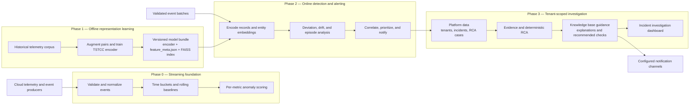

# System architecture

Phase 0 provides a statistical streaming/scoring path, and Phase 1 independently
trains a representation model from historical data. Phase 2 consumes validated
event batches and a registered Phase 1 bundle; Phase 0 scores are not currently
passed into Phase 2 or attached to an `RCACase`. Phase 3 turns Phase 2 alert
evidence into tenant-scoped incidents, deterministic RCA, static knowledge
guidance, and analyst-facing views. Notification delivery is configured per
tenant and channel.
